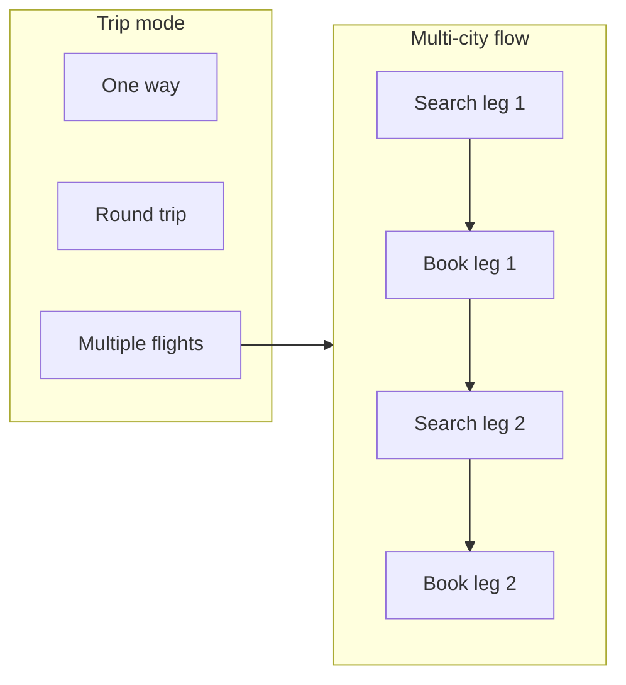

# Multi-segment search & book (one flow)

## Current behavior

- All flight UX is in [`src/pages/AdminTicketsPage.tsx`](src/pages/AdminTicketsPage.tsx): trip type is only **One way** or **Round trip**; each search calls [`searchFlights`](src/api/flightSearch.ts) with a single `from` / `to` / `departureDate`.
- The GDS-style API can return **one `Flight` with multiple itinerary segments** (connections, layovers). The UI already surfaces this in [`FlightResultCard`](src/pages/AdminTicketsPage.tsx) (stops badge + expandable segments).
- [`bookFlight`](src/api/flightSearch.ts) accepts **one** `flight` per request—there is no batch book endpoint in this repo.

So "book Mumbai→Bangalore and then Bangalore→Chennai in one flow" is a **product/UX layer** on top of the same APIs: multiple **one-way** searches + multiple **book** calls in a guided sequence.

## Recommended UX

1. **New trip type** (radio alongside One way / Round trip): **Multiple flights** (label can be tuned, e.g. "Multi-city" / "Split journey").
2. **Segment builder**
   - Default **2 segments**; **Add flight** adds a third row (cap e.g. 4–6 if you want a safety limit).
   - Each row: From / To / departure date (reuse existing [`AirportCombobox`](src/pages/AdminTicketsPage.tsx), [`DatePickerTime`](src/components/ui/date-picker-time.tsx) patterns from the one-way form).
   - When the user edits segment *i*'s **To** airport, optionally auto-set segment *i+1* **From** to the same airport (common hub handoff).
3. **Guided flow (stepper)**
   - Show **"Leg 1 of N"** (or a compact step list) so the user never loses context.
   - **Search this leg** runs `searchFlights` with `tripType: 'one-way'`, that segment’s O/D/date, and the same shared fields as today: `project_id`, `crew_ids`, `adults`, `cabinClass`, `currency`, pagination.
   - Results reuse **`FlightResultCard`**; **Book Now** still calls `handleBookNow` → `bookFlight` for the chosen offer.
   - On **successful** book: toast (existing), refresh balance (existing), then **advance to the next segment** (clear results, show next leg’s search fields pre-filled). After the last leg: a short **completion** toast or inline summary ("N bookings completed") and reset or offer "Start new multi-city search".
4. **Optional: fewer connections per leg**
   - Add a checkbox **"Prefer non-stop for each leg"** (or "Direct flights only").
   - Implementation: pass `stops: ['0']` (or the value your backend expects) on `SearchPayload` **if** the crew-ticket API documents support—[`SearchPayload.stops`](src/types/flight.ts) is `string[] | undefined` but is never set today. **If the backend ignores it**, fall back to **client-side filter**: keep only flights where the aggregated `stops === 0` (same logic as `FlightResultCard` today) so users are not pushed into booking a connection when they wanted separate tickets.

## State & code organization

- Keep **one-way / round-trip** behavior unchanged (existing `handleSearch`, `handleLoadMore`, `handleSearchBack`).
- For multi-city mode, either:
  - **A)** Dedicated state: `multiSegments[]`, `activeSegmentIndex`, and branch the render (form + results) on mode; or
  - **B)** Reuse `searchFrom` / `searchTo` / `departureDate` by **syncing** them from `multiSegments[activeSegmentIndex]` when entering search/results for that leg (slightly trickier).

Recommend **A** for clarity in a file that is already large (~1.7k lines).

- **Booking ID state**: today `bookingFlightId` is a string; for multi-leg consider `segmentIndex + flight.id` or a small object so the loading spinner targets the correct row if you ever show a combined view.

## Backend coordination (out of repo but important)

- Confirm what **`tripType: 'split-tickets'`** is supposed to do on `POST /api/crew-ticket/search-flights`. If it already implements split ticketing, you might **wire the UI to that** instead of only chaining one-way calls—otherwise leave `tripType` as `'one-way'` per segment (safest without docs).
- Confirm **`stops`** filter semantics for search so "direct only" is server-accurate, not filter-only.

## Files to touch

| File | Change |
|------|--------|
| [`src/pages/AdminTicketsPage.tsx`](src/pages/AdminTicketsPage.tsx) | Trip type radio; multi-segment state; stepper UI; segment-scoped search/load-more/back; advance after book; optional direct-only filter |
| [`src/pages/AdminTicketsPage.css`](src/pages/AdminTicketsPage.css) | Styles for segment list / stepper / leg summary (minimal, match existing admin-tickets patterns) |
| [`src/types/flight.ts`](src/types/flight.ts) | Only if you introduce a small shared type for a segment (optional) |

No change strictly required to [`src/api/flightSearch.ts`](src/api/flightSearch.ts) unless you add a new exported helper; existing `searchFlights` / `bookFlight` are sufficient.

## Partial failure

If leg 2’s `bookFlight` fails after leg 1 succeeded, show an explicit error toast and **keep the user on leg 2** with results intact; do not roll back leg 1 (no undo API). Mention in UI copy that each leg is a **separate booking**.

